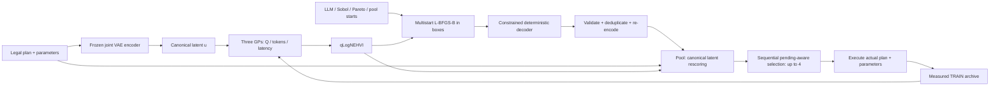

# TRACE 方案 B：联合计划参数 VAE 与连续 latent 多目标 BO

日期：2026-11-04。状态：设计提案，供用户 review；尚未实现、训练或启动实验。本文提出独立后端 `latent-mobo-v1`，不替换正在运行的 PR。RL 不在本版范围。

## 1. 目标与关键决定

**目标：将执行计划顺序、算子实现、有效参数共同编码为连续向量，用多起点 L-BFGS-B 优化 qLogNEHVI，解码后按真正的可执行配置重新评分，选择值得 profiling 的配置。**

用户已确定：联合计划＋参数、多目标 Bayesian optimization、先设计编码/解码/选点，不研究 RL。沿用之前提出的 campaign 预算：两轮初始化，每轮 5 Sobol＋5 LLM，共 20 个；之后探索 30 个，每批最多 4 个；TRAIN 随机固定 100 tasks，TEST 固定 200 tasks，仅搜索结束后评测 TRAIN Pareto。本文所有网络、训练量、数值阈值及计算预算是**建议默认值**，不是已验证结论或用户已批准的实现。

第一版选择：小型结构化序列 VAE，latent 8 维；确定性受约束 decoder；冻结 encoder/decoder；三个独立 GP；连续 proposal 后重新编码和评分；四来源池保留 Sobol、LLM、Recombination，以 latent refinement 替换 PR 通道。不训练任意大型 DAG 的生成器。

准确的方法定位是**连续 surrogate acquisition 引导的候选生成＋合法投影后多目标 BO 选点**。L-BFGS-B 最大化连续松弛的评分，不是精确求解离散可执行域的全局 argmax；本提案不能以这种松弛本身作为效果保证。

## 2. 当前实现审计与兼容边界

| 当前位置 | 已核对事实 | 本方案处理 |
|---|---|---|
| `trimem/optimizer/plan_schema.py` | schema=`trace-pr-v060-engine-ext-v1`；18 决策＋6 masks；V 固定 task ANN | 复用 canonical config、PlanSpec、capability manifest、key |
| `plan_codec.py::JointCodec` | 24 维规则编码；只接受合法离散坐标 | 保留用于旧 PR 和审计；新增 learned codec，不改变旧输入语义 |
| `plan_surrogate.py` | 三个 MixedSingleTaskGP、真实 raw score、负 log1p costs、qLogNEHVI | latent 分支改为连续 SingleTaskGP；复用 metric contract |
| `joint_search_controller.py` | Sobol/LLM/recombine/PR、≤25 starts、pending-aware q=4 | 复用候选来源与账本，换 refinement 和 latent scoring 接口 |
| `aggregate_panel` | 当前还支持 `allow_partial` 将 pruned 样本送入 GP | 本版 pilot 默认完整 panel 入 GP；partial 留存但不作为完整标签，比较 arm 同一策略 |

当前 `LIVE_DOMAINS` 包含 filter_order=none/before/after，graph=BFS/best-first/beam/MCTS，三个 Rank，whole/actions/window，start/periodic，direction=Backward/Forward/Both；edge_threshold 固定 off。全 schema 另有 both、relational、evolutionary 等。**这些是源码声明，不等于运行能力已经验收。** 训练和运行必须读同一份通过执行合同验收的冻结 manifest；未通过的选项排除。旧 v0.4.2 的空间数字和 vector_impl 字段不能照抄；不恢复 single/multi vector，不引入 sim_gate。

计划只生成 `V → [F_pre] → G → [F_post] → Rank` 语法下的已启用结构。它是有向无环计划的有限模板集合，不宣称可生成任意 DAG。物理执行仍遵守 Open/Next/Close、native graph AM、已批准 bounded ranking pool，不改执行引擎。

## 3. 表示：共同压缩，而不是类别 ID 当连续数

示例合法配置（是否可实测由 manifest 决定）：

```text
V(task ANN, seed=16) → F_pre(LLM, threshold=.6)
 → G(beam, depth=2, fanout=8, beam_width=4, direction=Forward)
 → Rank(ColBERT, returned_k=5)
unit=whole; timing=start; category=All; edge_threshold=off
F_post / sem_threshold_post / retrieval_interval = INACTIVE
```

序列为 `[BOS], filter_order:before, graph_impl:beam, filter_pre_impl:LLM, ...,
seed_count:16, depth:2, fanout:8, ..., [EOS]`。字段顺序固定为 schema 字段顺序；每个 token 带 field ID、owner-role ID（V/F_pre/G/F_post/Rank/injection）、value embedding 与 activity bit。类别 value 是 embedding lookup，不把类别 ID 的大小当距离。ordinal 除 value embedding 外，加当前 codec 的冻结数值变换（seed/fanout/beam 用 log2，其余按现有定义）；非等距档位保留真实数值信息。无效字段唯一表示为 INACTIVE。

Encoder 建议 2 层 Transformer、hidden=64、4 heads，pooling 后给出 `mu(c), logvar(c) ∈ R^8`；训练时 `z=mu+sigma*epsilon`，epsilon~N(0,I)。**部署编码固定使用均值 `E(c)=mu(c)`，不随机抽 latent。** 全部计划与参数通过 attention 共同进入 z；某个 z 坐标不再对应 seed 或 plan ID，也不保证语义可解释。

`z=[0.31,-0.72,0.14,0.88,-0.20,0.06,0.43,-0.51]` 只是假想示意，具体值来自训练；不能人工指定这些数值后声称学到了表示。配置身份永远由 canonical config key 决定，不能用浮点 z 的 hash 代替。

## 4. 解码：先决定结构，再填充有效实现与参数

采用小型 autoregressive Transformer decoder，cross-attend latent token；按 schema 顺序逐字段生成。解码每一步的 allowed-value mask 来自冻结 manifest 与已生成的父字段：先 filter_order/graph_impl，再各 Filter/Rank 实现，再参数。beam_width 仅 beam 激活；threshold 仅对应 LLM Filter 激活；interval 仅 periodic 激活。inactive 输出 INACTIVE，禁止默认填充未知值来掩盖模型错误。

第一版固定 greedy argmax、固定 tie-break、eval mode，无 dropout/temperature sampling。同一个 z 和版本必须返回同一 c。完整 raw record 先严格校验字段完整性、类型、依赖与 capability，再 canonicalize、构造 PlanSpec；空 allowed set、NaN 或执行合同失败即拒绝。若后续 manifest 有跨字段约束，mask 必须检查前缀至少存在一个合法补全，不能只检查单字段合法。

规则保证的是**有限且数值有效 z 经成功解码后属于已支持配置域**，不保证高质量、覆盖整个域、重构所有输入或使相邻 z 性能相近。生成后仍检查真实执行能力。VAE 的重参数化是训练方法，与原 PR 优化类别概率 theta 是两件事。

## 5. Encoder/decoder 的训练数据与验收

训练样本只需合法配置，不需跑 agent。建议先构造 N=10,000 个 canonical unique configs（空间不足则枚举），按 filter_order/graph_impl/rank_impl 分层，补足罕见 active-field 档位及联合变化，避免只覆盖默认 BFS。初始化20个key强制保留在训练分区。先选择约10%作为表示test，其中指定的二元/三元实现-参数组合在train/validation完全不出现，但每个单独token必须在train出现；记录holdout组合规则和key清单，再把其余key分成80%训练与10%validation（比例以N为分母）。达不到整10%的组合holdout时，用普通未见key补足test并分组报告；若支持域太小，明确报告未能建立有意义的held-out combination test。最终split清单冻结，不能为了重构率删除难例。

损失：有效字段平均重构 CE＋0.1×ordinal 数值重构误差＋beta×KL；ordinal 误差用冻结归一化数值的预测期望与真值之差平方，不能混用原始 fanout 与 threshold 尺度。beta 从 0 线性升到 0.01（前 10 epochs），AdamW lr=1e-3、batch=128、最多 100 epochs，validation exact-config reconstruction 连续 10 epochs 无改善停止。inactive 位置由 grammar 决定，不让大量 INACTIVE token 虚增重构准确率。以上超参数均为待校准建议；独立表示训练不使用 TEST task score。

先评估 d=8；若 validation gate 失败，尝试 d=16，再把语料扩到 50,000（不超过空间大小）。模型选择只用 validation；test 一次性汇报。超过该上限仍失败，标记方案未就绪，不静默用旧 PR 代替 latent 实验。初始化 20 个实际配置在 VAE 训练前冻结并属于训练分区；相同初始化用在所有探索方法。表示训练集不能包含 encoder 测试分区；agent TEST tasks 和表示重构测试配置是不同概念。

建议 readiness gates：validation/test 分别报告逐字段和整配置 exact match；validation 整配置重构≥95%、每个启用 plan family≥90%；初始化 20 点全部 `D(E(c))=c`；10,000 个有限、有界 latent probe 解码成功且合法的比例100%（失败计入分母）；训练/validation 的不同 key 无数值精度内的编码碰撞。probe unique rate、各计划覆盖和 latent 距离/实测指标差异均报告，但不编造达标结果。重构高并不证明 BO 样本效率高。

## 6. 关键桥接：GP 学什么，连续搜索得分如何落到配置

选择**规范编码 GP**：每个真实配置只有一个模型位置 `u(c)=A(E(c))`，A 是冻结的逐维仿射缩放。先计算表示训练集 latent 均值/std（std floor=1e-3），每维原始上下界初值为 mean±4std，再扩展到包含全部表示训练样本及初始化编码，并加原宽度5%的边距；随后把这对上下界线性映到 [0,1]，冻结A。A对域外仍是可逆仿射，不clip；validation/test不参与定bounds。连续搜索域限定 [0,1]^d。新解码配置重编码落在域外可以评分并直接提交，但跳过其连续refinement起点，不能裁剪u后改变配置位置或运行中改A。

GP 训练数据是 `(u(c_i), y_i)`，不是任意 proposal z 的得分。目标为 `y=(mean raw score, -log1p(mean total tokens), -log1p(mean total latency))`；raw score 保留负分。采用三个独立 `SingleTaskGP`＋ARD Matérn 5/2＋ModelListGP，提供变换后的观测均值方差和 Standardize outcome transform。每数据集单独建 GP；搜索 surrogate 不替换 Query Router predictor。

连续梯度阶段优化光滑代理 `ell(u)=qLogNEHVI(u|D)`。令 `P(u)=A(E(D(A^-1(u))))`，真实可提交候选的评分是 `ell(P(u))`。**我们不声称连续 ell 就是分段常数的真实 Profile(D(u))；也不对包含 argmax decoder 的 ell(P(u)) 直接求梯度。** 优化终点必须解码成 c，再在 u(c) 重新评分；终点的原始高分不能直接决定 profiling。记录 proposal/canonical 坐标距离及前后 ell，用来检测 GP 被 decoder 空洞误导。

不要求所有新 c 都满足 D(E(c))=c 才能直接执行，因为 executor 输入是已经合法的 c；但 round-trip failure 必须记录，且这种 c 不用作连续 refinement 起点。初始化要求 round-trip 成功是为了建立可靠的初始锚点。重复编码/解码不循环到收敛；只执行一次明确的投影与重新评分。

## 7. 多目标定义与真实反馈

沿用 `ObjectiveProtocol`：完整初始化后冻结每目标 lo/span，span floor=(1,1e-3,1e-3)，归一化 y=(target-lo)/span，ref=(-.1,-.1,-.1)。HV 基于完整 TRAIN 实测非支配点；NHV=HV/(1.1^3)，可能大于1。所有 arm 用同一初始化和 frozen transform/ref。qLogNEHVI 用 GP 后验，包括噪声；预测分数不是实测 HV 增益。

坐标合同：raw统计量 `(Q,T,L)` → `target=(Q,-log1p(T),-log1p(L))` → `y_norm=(target-lo)/span`。传入GP的是 `train_Y=y_norm` 和 `train_Yvar=var_target/span²`；`Standardize` 仅是GP内部训练变换，BoTorch posterior自动反变换回输入的y_norm单位。qLogNEHVI的ref、posterior样本和汇报HV一律使用y_norm；不得把ref再手工做Standardize，也不得对posterior重复反变换。验收添加变换/反变换、方差缩放与HV手算对照。低于ref的观测仍可进入GP，其在ref上方正正交区域的实测HV贡献为零；不要求所有未来观测都支配ref，不删除负分或较差样本。报告这类点的比例，ref始终不随结果漂移。

噪声的统计解释：GP估计固定任务采样分布下的配置期望表现，100-task共同panel是该分布的样本；task方差/n作为population均值不确定性的近似，并按log变换传播。这不是“固定panel均值的纯执行噪声”。共享tasks造成跨配置相关性，独立GP noise对角矩阵忽略这种相关性，须在局限中披露；不能用该近似生成声称严格覆盖率的置信区间。有限panel的实测HV曲线是描述性统计；若未来要建模该panel本身的条件均值，则需独立重复执行估计噪声，不能照搬task方差。

每一配置使用同一随机抽取后固定的 100 TRAIN task IDs/顺序，完整 panel 进入 GP；噪声由 task 明细估计并传播至 log-cost。初始化、候选、重试、TEST 与表示训练成本分别记账。TRAIN 的 staged pruning 首版关闭以隔离表示与选点改动；当前代码 partial-label 路径必须显式禁用。本政策应用到本设计的对照实验所有 arm，不改当前后台任务。后续如恢复 pruning，需要单独处理选择性停止偏差，不能仅提高噪声便当成无偏完整均值。

真实完成后更新 archive → 重拟合 GP → 下一批；VAE 首版全程冻结。编码器升级是新实验分支，必须重编码全 archive、重新拟合 GP、重建 pending 坐标及 bounds，禁止新旧 latent 混用。

## 8. 怎样选点：多起点、连续梯度、合法候选池

每轮先产生合法配置池：Sobol 256、LLM≤4、Recombination≤64；全部 canonicalize、编码。起点复用现有选择器语义：LLM≤4（无可用时 crossover≤4）、质量/成本/前沿 incumbent≤5、新 plan 默认点≤3、独立 Sobol 8、池 top-8；按现有优先级去重截断≤25。允许 measured 配置当起点，但绝不能再次占新 profiling 名额。新计划覆盖的不足显式记日志，不声称≤25一定覆盖所有来源。round-trip 失败的起点跳过，以独立合法 Sobol补足。

每个起点 a 设 box `R(a)=[a-h/2,a+h/2]∩[0,1]^d`；h初值0.4、下限0.05、上限1.0。每批重选锚点，因此可以沿改进路径移动，不是永久锁定初始邻域。一个全局 h 控制所有 box，避免 50 次 profiling 下训练过多独立区域状态。连续三批 measured normalized HV 增益>1e-4则h翻倍；连续三批无此增益则减半，计数互斥且触发后归零；收缩到下限后再连续三批失败则h重置0.4并刷新 Sobol anchors。该控制是本方案的多目标启发式，不称为原版 TuRBO，也不保证因果上是 latent 通道带来改善。

对每批第 j 个名额，pending包含正在运行及本批已选配置，固定 GP、reference 和 MC base samples（64 QMC draws）。在各 box 内从 anchor 开始 L-BFGS-B，最多50 iterations、100 objective calls/起点；自动微分 `grad_u ell` 只穿 GP/acquisition，不穿 decoder。每批总上限300秒、10,000 objective calls；只在完整 optimizer evaluation/候选验证边界停止，返回已验证候选。候选数量计数和前后向 calls 分开记录；使用 timeout wrapper，避免 scipy 某一调用无限延长。所有 optimizer 参数和 library版本写 manifest。

pending API合同：每slot构造 `qLogNoisyExpectedHypervolumeImprovement(model, ref_point, X_baseline=U_observed, X_pending=U_reserved_or_running, sampler=...)`，或使用该类支持的 `set_X_pending` 并重建有关缓存；传入canonical u(c)，q=1待选点。利用acquisition内部对pending结果的不确定性积分，不把pending塞入训练标签，也不只靠key排除来冒充pending-aware。重启从持久化reservation状态重建集合，随后创建新snapshot。

计算调度：整批剩余time/calls平均分给剩余slot，各slot平均分给尚未访问的anchor；以run seed＋round＋slot冻结shuffle顺序，跨slot轮转，未用份额转给后续anchor。每anchor遵守其更小的time/calls配额；超时终点只有通过合法检查才保留。记录每个anchor分配/实耗、完成/超时、投影后独立key数，不能将未访问起点记为“搜索无改进”。这些限额是首版建议；通过离线预检校准后、真实搜索前冻结，不在结果不好时临时加预算。

`optimize_acqf(q=1, batch_initial_conditions=..., return_best_only=False)` 或等价 `gen_candidates_scipy` 为候选端点实现方向；不同 box 分组调用。保留各终点，去重后每名额最多25个 latent 候选；不默认需要自定义 SciPy trajectory callback。收敛/超时/梯度NaN分别记录；失败起点不伪造得分。

每个终点解码、严格验证、canonicalize，得到 c；合并显式池，以 u(c) 统一评分。排除 measured、pending、本批已选及终止失败 key。按 pending-aware qLogNEHVI 选最高分合法 key，原子 reservation 成功后加入 pending；下一名额重新评分，余下预算允许时重新优化连续端点。禁止直接取同一轮静态分数最高的4个。预算耗尽后只在已生成合法池中继续 greedy 选择；若不足4个，Sobol合法补充最多4096次draw并评分，仍不足则提交小批并记录原因，不耗 profiling 预算重测旧 key。最终批30个探索预算余2时q=2。

重要：global Sobol/LLM/recombine 仍在合法配置域提案，然后进入共享 latent 模型评分；latent refinement 才是直接在连续 u 上走梯度。所有来源都参与计划＋参数联合优化，并不声称所有来源本身都在 latent 中生成。

## 9. 一轮伪代码与例子

```text
fit three GPs on canonical u(config), measured TRAIN Q/T/L
pool = canonical_unique(Sobol(256) + LLM(<=4) + recombine(<=64))
anchors = select_valid_roundtrip_starts(archive, pool, limit=25)
selected = []
for slot in remaining_batch_slots(maximum=4):
    acq = frozen_qLogNEHVI(model, ref, pending + selected, QMC_seed)
    if proposal_compute_budget_remains:
        endpoints = multistart_LBFGSB(acq, anchor_boxes, bounded_budget)
        pool += validate_and_decode(endpoints)
    legal = unique_unreserved_configs(pool)
    if not legal: legal = bounded_legal_sobol_backfill()
    if not legal: break
    chosen = argmax_c acq(canonical_latent(c))
    reserve_atomically(chosen)  # on conflict, refresh pending, rerank; bounded retries
    selected.append(chosen)
profile(selected, same_100_TRAIN_tasks)
persist_complete_observations(); update_measured_HV_and_box_width()
```

示意：从 before+beam+seed16 的 u_A 出发，梯度终点 u* 解码为 after+BFS+seed32。`ell(u*)=-2.1`，重新编码后 `ell(u(c*))=-3.0`；另一个 LLM 候选规范位置得分为 -2.6，则在同一 pending snapshot 下选择 LLM 候选（-2.6更高），而不是用投影前-2.1抢占名额。数值全为说明算法的虚构示例，log acquisition 可以是负值。

## 10. 可视化流程



## 11. 实现边界、资源与恢复

新增建议模块：`latent_plan_codec.py`（serialization/VAE/masked decoder）、`latent_plan_corpus.py`（frozen splits）、`latent_plan_surrogate.py`（continuous GP/acquisition）、`latent_plan_search.py`（bounded multistart/projection/pool）。将 `backend=explicit-pr|latent-mobo` 放在新实验入口；旧 codec、PR默认和历史run保持可恢复。GP梯度路径不能调用现有 `AcquisitionSnapshot.score` 的 `no_grad/detach` 缓存；为latent提供张量接口 `acquisition_u(u, requires_grad=True)`，仅规范候选评分可以缓存float，cache key含模型/pending/representation版本。

checkpoint必须保存 corpus/splits、schema/capability/execution hash、VAE weights/tokenizer、A/bounds、GP targets/noise、objective/ref、round/slot、h与success/failure、RNG/QMC seeds、候选provenance、config/evaluation keys、reservation状态。config_key继续采用当前 `JointSpace.key`；VAE版本是优化器指纹而不是新的配置执行身份。evaluation_key再含dataset/panel/agent/metric/seed，跨协议不复用测量。恢复先核验pending真实状态，再重新生成临时acquisition缓存；原子冲突最多重选8次后退出该批并保留已预留项，不忙循环。

持久化状态机：`reserved → submitted(run_id/idempotency_key) → completed_raw → archived`，另有failed和submission_unknown。以evaluation_key＋task_id＋attempt_id保存不可变episode receipts；用evaluation_key唯一约束原子提交archive和预算账本。崩溃恢复先查外部run_id及原始产物；completed_raw重聚合即可，不重跑已完成task。提交前先持久化request ID；无法判定提交是否成功的标记submission_unknown，等待核实而非盲重发。确认未提交的reservation可释放；首次真正submitted消耗一个unique配置名额，即便最终失败也不自动补一个新配置。允许每个失败task最多一次显式重试、所有重试不超过名义candidate episodes的10%，重试成本另计且失败配置不伪装为完整GP观测；这些是待批准的运行上限。恢复支持同配置继续缺失tasks，不重新消耗unique名额。

资源建议：VAE单worker，CPU threads≤4，单卡显存≤4GiB或CPU；优化器CPU double，threads≤4，RSS硬限制8GiB、单批优化300秒。监控worker资源；超限中止该优化步骤并保存checkpoint，不能杀其他实验或退回无约束枚举。proposal/gp失败时停止并报告，不以假分数继续。300秒只限制proposal，另记录GP拟合≤120秒预算和LLM超时，agent profiling使用现有独立资源合同。训练时间、GP拟合、LLM调用、候选优化、profiling均记录真实wall-time；不能只报agent时间。

## 12. 实施顺序与验收

1. **schema/corpus**：导出通过执行合同的manifest，构建canonical语料和固定splits；校验active masks、非等距档位、filter none/both、所有Rank实现；没有执行能力证据的选项disabled。
2. **representation**：小训练跑与held-out reconstruction；覆盖所有启用分支的decoder property tests、确定性和finite/invalid输入测试；统计合法率、重复率、round-trip和碰撞；满足§5gate才进入BO。
3. **search unit smoke**：使用可枚举缩小域的人工多目标函数，标记synthetic；验证三个GP、连续acq梯度有限差分、解码重评分、measured/pending dedup、q=4及末批q=2、预算、重启reservation一致性。证明控制流与目标实现正确，不能作为agent改善证据。

   另在20点完整初始化后、开始30点新增profiling前做无需新agent执行的proposal预检：同一冻结GP上用3个预先固定proposal seeds，各运行一批预算；合计须至少产生4个未测合法unique latent来源配置，且至少一次投影后候选的ell超过其原始anchor（数值容差1e-6）。报告前后ell差分分布、endpoint/unique比、投影前后排序相关性及相对同计算预算合法Sobol池的最好ell；不以这些代理诊断代替真实HV验证。gate不通过则停止新增profiling、保存诊断，不静默切成PR或调参到通过；修改表示需新版本、新预检记录。预检时间计入该arm总开销。
4. **agent smoke（后续单独启动）**：少量合法配置验证配置实际落地、metric计时边界与历史协议一致。正式20+30预算必须重新确认资源与历史指标可复用性；不会因为设计完成自动开始。
5. **比较**：共享20点初始化/同一100 TRAIN tasks/30新配置预算；显式PR与latent-qLogNEHVI为主要对照，latent Sobol+TS只是后续可选，RL排除。固定200 TEST仅用于TRAIN Pareto最终评价。报告TRAIN NHV–总搜索时间、NHV–unique profiles、raw Pareto；同时报告representation训练开销、投影前后得分变化、unique proposals/acq second、latent来源被选率、失败和fallback次数。

   TEST规则固定为：对每个arm最终完整TRAIN archive中的**全部TRAIN非支配配置**运行相同200 TEST任务；按config/evaluation身份去重后可共享完全相同配置的TEST执行，不按TEST选点。每arm工作量=`200×该arm TRAIN Pareto配置数`，不同arm可不同，且另计于20+30 TRAIN预算。TEST不能参与VAE/GP/超参数/门槛/候选选择。首版沿用单seed，只报告可行性case study，不据一条曲线断言方法普遍优于PR。

   Latency比较须冻结相同agent参数、模型、graph、retrieval语义、task concurrency=16、缓存冷暖策略和硬件资源；各arm的完整配置批次按预置seed交错排程，记录显存、主机内存、CPU/GPU负载与共驻任务，不能边跑VAE训练边测agent latency。外部任务争用时暂停新提交并保留已完成receipt，不按latency好坏删数据；已受争用的样本单列、该次latency比较标记受污染。若要重测须新evaluation attempt和另计预算，不能覆盖旧值。统计性优越结论和漂移建模留给后续多seed实验。

停止条件：VAE重构不足、编码碰撞、decode重复严重或GP梯度步骤被投影消解时，报告失败诊断并与显式PR比较；不能仅凭“连续空间”宣称探索更有效。不会保证新点真实HV提升、保证跳出局部最优或到达所有合法配置。

## 13. 文献依据与本方案的新设计

- [BayesQO](https://arxiv.org/html/2502.05256)：借鉴可生成计划表示与latent BO；其主要选点路线是trust-region候选＋TS，本方案换为三目标qLogNEHVI梯度优化，不称为直接复现。
- [BoTorch optimization](https://botorch.org/docs/v0.17.1/optimization)：支持自动微分acquisition、多起点L-BFGS-B及批量选点。本文选择sequential pending-aware q≤4是为处理解码重复，不声称该策略总比joint q优化快。
- [AQETuner](https://www.vldb.org/pvldb/vol18/p2709-han.pdf)：借鉴plan/knob联合表征思想；它的预测编码器不提供本方案需要的逆decoder。
- [本地源码审计](../../../results/trace_literature_atlas_20261031/notes/aqetuner_bayesqo_joint_representation_20261104.md)：保留论文与代码差异及commit记录。

本方案自己的决定：联合配置序列VAE、确定性masked decoder、canonical latent投影后重评分、HV反馈的移动box、已有四来源与原子去重账本的整合。尚未实验证明优于当前显式PR。

Addendum 2026-11-04 (user): 16 anchors = LLM 4 / front 4 / newplan 4 / random 4; live kernel Matérn × 3.
