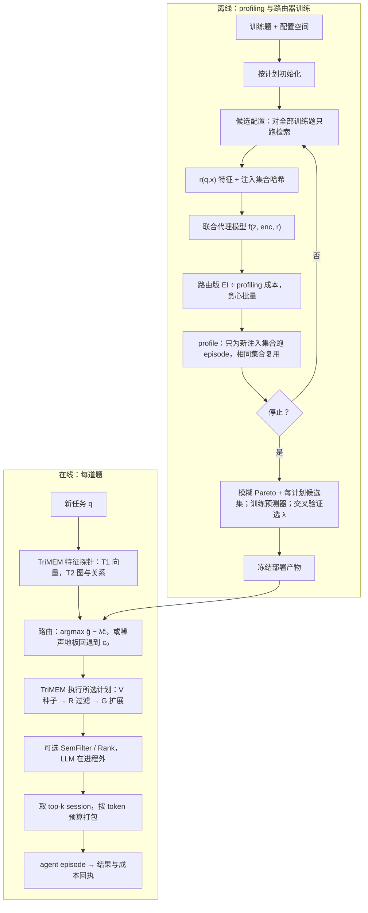

# TRACE 设计修订 v0.2.0：为逐题路由而探索

状态：**设计提案，未实现，未验证。** 2026-10-19 与用户讨论形成。本文不改动任何代码，也没有运行新实验。
它修订的是 TRACE 设计评审稿 *Performance and Quality Co-optimization for Agent Trajectory
Retrieval*（以下称"原草稿"）。原草稿描述的 profiling、四通道探索和 BRANE 路由仍是本文的出发点。

## 0. 范围与已确认的前提

| 项 | 决定 | 来源 |
|---|---|---|
| 论文形态 | TriDB 系统与 TRACE 优化器合为一篇，投 SIGMOD research track | 用户 |
| 数据集 | ALFWorld、"AgentWorld"、"Smith-SWE" | 用户；后两个名字待确认，见 §8 |
| 记忆库 | 静态，episode 产生的新轨迹不写回 | 用户 |
| 检索延迟 | 接受它不是端到端瓶颈，TriDB 退为 substrate | 用户 |
| profiling 规模 | 每个配置跑同一批 100 到 200 道训练题，矩阵稠密；BO 共探索约 40 到 50 个配置 | 用户 |
| "放宽版 BRANE" | 最终候选集保证每个检索计划至少有一个配置 | 用户 |

## 1. 现状诊断

数据来自 held-out 测试集的结果页（`render_atlas_results.py` 生成，2026-10-18）。

| 数据集 | No-Memory | 最好固定计划 | BO Q-best | 放宽版 BRANE | 逐题配对 SE |
|---|---|---|---|---|---|
| ALFWorld | 0.655 | VGR 0.890 | 0.930 | 0.930 | ≈0.033 |
| ScienceWorld | 0.728 | VGR+SemFilter 0.884 | 0.835 | 0.885 | ≈0.030 |
| AppWorld | 0.732 | VGR 0.810 | 0.786 | 0.815 | ≈0.031 |
| WebShop | 0.323 | VGR+Rank 0.569 | 0.541 | 0.552 | ≈0.036 |

三点结论：

1. **记忆的收益很硬，计划之间的差异很软。** 有无记忆相差 0.08 到 0.24，而计划之间的差距几乎都落在一个 SE 以内。
2. **优化器唯一明确的胜利在成本。** 在 ScienceWorld 上，路由器以 SemFilter 约 79% 的 token、62% 的延迟达到同等质量。
3. **检索不是瓶颈，SemFilter 才是。** ALFWorld 上 VGR 检索侧耗时 0.59 s，而生成耗时 33.5 s；SemFilter 检索侧耗时 32.9 s，另加 1.9 万 token。X1 实验中，同一检索 TriDB fused 为 24 ms，三服务拆分为 15 ms，而 episode 均值为 39.5 s。

另外，AppWorld 上 BO Q-best 在训练集最优，冻结后测试集却低于默认 VGR（0.786 对 0.810）。原因是训练集上各配置的差异落在噪声地板之内，选出的"最优"只是噪声。

## 2. 两篇相关工作的核实结论

两篇论文已逐节阅读（arXiv 2608.03487v1 与 2605.27361v1）。

| | RAG-Stack | BRANE |
|---|---|---|
| profiling | 多目标 BO 探索，每个数据集 50 次评估，3 个随机种子 | 全量网格：profiling 池中每道题 × 每个可运行配置 |
| 规模 | 每个数据集 100 道题 | 600 × 131、600 × 60、150 × 335；600 × 60 约花 1.1 万美元 |
| 质量粒度 | 100 道题的均值，作为单一目标 | 逐题 0/1 正确性，组成 N × M 矩阵 |
| 训练测试划分 | 未见留出 query；前沿在同一批题上报告，"re-measure" 指换硬件后重测性能 | 按 query 做 5 折外层交叉验证，内层 3 折选模型 |
| 部署选点 | 产出 Pareto 集，用户按 SLO 选一个点，整个 workload 共用 | 逐题选 argmax p̂_c(F(q)) − λ·cost(c)；准确率目标在 profiling 样本上校准为 λ |
| 题目特征 | 无 | GPT-5-mini 提出约 10 个 workload 专属二值特征，再逐题打标签；embedding 只是消融对照 |
| 候选剪枝 | 不适用 | 模糊 Pareto：τ_acc = 0.02，τ_cost = 0.10 |
| 已有的结果复用 | 检索段落与下游配置都相同时，复用之前的质量分 | 无 |

**两处更正。** 讨论早期我曾说 BRANE 的输入是文本 embedding，这是错的。也曾把"注入集合相同就复用 episode"当作新点，这同样不成立，因为 RAG-Stack 已有 quality reuse。

**两篇都没回答的空白。** RAG-Stack 的采集函数为单点部署服务，奖励均值意义上的超体积提升。BRANE 假定能付得起全量网格，只在全量 profiling 之后剪枝。我们的场景两头都受限：一个 episode 要 40 到 90 秒，全量 865 个配置付不起；最终的部署方式又是逐题路由。

## 3. 改动清单

每条注明相对原草稿是新增、修改、沿用还是降级。

| 编号 | 主题 | 原草稿 | 修订后 | 类型 |
|---|---|---|---|---|
| C1 | 论文主线 | TriDB 三模态一进程 + TRACE 优化器并列 | TriDB 为 substrate；主线是逐题、成本感知的经验检索优化。系统贡献落在"库内统计特征"和"检索与 episode 成本分离"上 | 修改 |
| C2 | 探索的贡献 | 四个提案通道（Sobol、局部搜索、交叉、LLM analyzer） | 四通道保留为实现细节，并注明来自 RAG-PE。核心贡献改为"为路由而探索" | 降级 |
| C3 | 结果复用 | 相同注入记忆的 episode 可复用 | 保留，但引用 RAG-Stack，不作贡献；只作为 profiling 成本项进入采集函数 | 降级 |
| C4 | 探索的价值函数 | 三目标均值上的超体积改进 | 特征分辨率上的路由价值与路由超体积，见 §4.1 | 新增 |
| C5 | 代理模型 | 逐配置的性能模型 | 联合模型 f(z_q, enc(x), r(q,x))，含只跑检索即可得到的特征，见 §4.2 | 新增 |
| C6 | 选点与批量 | 期望前沿改进或填补前沿空缺 | 路由版 EI 除以 profiling 成本，带成本的贪心批量，见 §4.3 | 修改 |
| C7 | 停止规则 | 预算耗尽 | 收益与成本比低于阈值，或路由超体积上界与最好单配置之差落入噪声地板，见 §4.4 | 新增 |
| C8 | 路由器特征 z(q) | "任务特征与相关经验的可得性"，未具体化 | 三层：T0 题干、T1 向量探针、T2 图与关系探针，见 §5 | 修改 |
| C9 | 路由标签 | 逐题质量 | 相对默认配置 c₀ 的逐题差值，以消除题目难度 | 修改 |
| C10 | 回退 | 训练集上验证后决定部署路由或单配置 | 显式的噪声地板回退：预测增益不超过逐题噪声估计时选 c₀ | 修改 |
| C11 | 候选集 | 模糊 Pareto 集 + 每个计划的最优点 | 不变；"每个计划至少一个"由按计划初始化与路由价值共同保证 | 沿用 |
| C12 | 评估协议 | 测试前冻结，测试结果不回流 | 不变；并明确与 RAG-Stack 的 in-sample 选点做对比，作为动机之一 | 沿用 |
| C13 | 逐步路由（Branch B） | 未列入 | 暂缓，作为可选的第二贡献 | 暂缓 |
| C14 | 记忆库规模轴 | 未列入 | 暂缓：库是静态的，ALFWorld 规模也看不出差异 | 暂缓 |

## 4. 为路由而探索

### 4.1 价值函数

S 为已 profile 的配置集合，始终包含默认配置 c₀。z_q 是路由器能看到的题目特征。μ_s(z) 是代理模型在特征 z 上对配置 s 的质量预测。

```
单点部署（RAG-Stack，现状）:  V_mean(S)  = max_{s∈S} (1/n) Σ_q [ μ_s(z_q) − λ·c_s ]
逐题路由（本文）:            V_route(S) = (1/n) Σ_q max_{s∈S} [ μ_s(z_q) − λ·c_s ]
```

新配置 x 的价值是 V(S ∪ {x}) − V(S)。在一组 λ 上画出路由后的（质量，成本）点，再取超体积，就得到 **routed hypervolume**。它与 RAG-Stack 的超体积目标形式平行，便于直接对比。

**必须用 μ_s(z_q)，而不是原始结果 y[q,s]。** ALFWorld 的结果是 0/1，且每格只跑一次。在 45 个配置上取逐题最大值，几乎每道题都会是 1。这是噪声造成的假互补，路由器无法利用。只有特征 z 能区分出的差异才算路由价值。原始矩阵上的 oracle 只能当作虚高的上界。

### 4.2 代理模型

联合模型 f(z_q, enc(x), r(q,x))：

- **z_q**：与路由器相同的题目特征，见 §5。
- **enc(x)**：计划的 one-hot 编码，以及 s、d、f、k、边类型。
- **r(q,x)**：只跑检索、不跑 agent 即可算出的特征。包括注入集合的大小和 token 数、平均相似度、注入 session 中成功的比例，以及与已 profile 配置在同一题上注入集合的最大 Jaccard 重合度。

不确定性用约 20 个 bootstrap GBDT 的集成来近似，与 `trimem/optimizer/router.py` 的 GradientBoosting 保持一致。

这里体现的是数据库视角：检索是毫秒级的，一个 episode 要 40 到 90 秒。所以在决定是否 profile x 之前，可以先在全部训练题上把 x 的检索执行一遍，看它会把哪些经验交给 agent。SemFilter 配置例外：它的 judge 结果若按（题目，候选 session）缓存，则 r(q,x) 仍然便宜；否则只能用过滤前的候选池特征。

### 4.3 采集函数与批量

在单个 λ 下，采集函数化简为逐题期望提升的平均，即逐题版 EI：

```
α_λ(x) = (1/n) Σ_q E[ ( f_x(z_q) − λ·c_x − b_S(q) )⁺ ],   b_S(q) = max_{s∈S} μ_s(z_q) − λ·c_s
```

多个 λ 时，用集成样本计算路由超体积的期望增量。

profiling 成本：cost(x) 等于 x 在训练题上产生的新注入集合数乘以单个 episode 的成本。按 α(x)/cost(x) 排序，与已有配置高度重合的配置因此能被廉价补入。

批量选择：μ 固定且 S 含 c₀ 时，V_route 是 facility location 函数，单调且次模。按基数约束贪心有 (1 − 1/e) 近似保证；带成本时用 CELF 式的成本收益贪心，保证为常数因子。每批 B 个配置逐个贪心选取，每选一个用预测值占位。μ 不确定时，这个保证只是启发，不是定理。

### 4.4 停止规则

满足任一条件即停：

1. max α(x)/cost(x) 低于阈值。
2. 路由超体积的上界减去最好单配置的超体积，落在噪声地板之内。

第二种情况下系统输出"该 workload 不需要路由，退回单配置"。AppWorld 是预期中的例子。

### 4.5 代码落点

现有探索在 `trimem/optimizer/search.py` 的 `suggest()` 中调用 qLogNEHVI，并已有按计划初始化。新采集函数可以作为与 `_qlognehvi` 并列的分支加入。环境类 agent 数据集的实验代码不在本仓库中，落点待用户告知。

## 5. 路由器的输入与训练

| 层 | 特征 | 计算方式 | 成本 |
|---|---|---|---|
| T0 | 题干 embedding 降到 16 到 32 维；task family；长度 | 不访问库 | 0 |
| T1 | top-1 与 top-k 平均相似度；相似度 ≥ τ 的 session 数及其中成功比例 | 一次 HNSW 探针 | 毫秒 |
| T2 | 关系过滤后的候选池大小；池内 task family 数；depth 2 与 depth 1 的池增长比；seed 平均度 | 一次 Expand | 毫秒 |

与 BRANE 的差别：BRANE 只能从题干文本提取特征，因为它在库外。对 agent 任务，两道题干几乎相同的任务，记忆是否有用取决于库里有没有相似且成功过的经验。T1 与 T2 正是这种信息，类似选择率估计所用的统计量。

训练流程：

1. 稠密矩阵上的标签取 g(q,c) = Q[q,c] − Q[q,c₀]。
2. 用共享的 GBDT f(z_q, enc(c)) 预测 g；逐配置模型作为消融。
3. 在训练集上按 query 交叉验证，对每个 λ 模拟路由，查矩阵中被选配置的真实结果，选出 λ。
4. 加噪声地板回退：若 max_c ĝ_c − ĝ_{c₀} 不超过逐题噪声估计，则选 c₀。
5. 冻结特征变换、候选集、预测器、均值成本和 λ，然后在测试集上只做预测与执行。

## 6. 修订后的流程



## 7. 验证计划

按成本从低到高排列，前三项不需要 GPU。

| 编号 | 实验 | 需要的数据 | 回答的问题 |
|---|---|---|---|
| E1 | 噪声地板：ALFWorld 20 道题 × 5 个配置，各重复 3 次 | 少量新 episode | 逐题方差多大；停止规则与回退的阈值 |
| E2 | 特征分辨率上的路由上界与原始 oracle | 现有 200 × 45 矩阵 | 路由的空间有多大，是否值得做 |
| E3 | 回放：45 个配置为全集，按随机、均值超体积、路由超体积、全知贪心挑 5 到 20 个，5 折评估 | 现有矩阵 | 为路由而探索是否比均值探索更好。全集由均值 BO 选出，所以结果偏保守 |
| E4 | 特征消融：BRANE 式 LLM 二值特征、文本 embedding、T0+T1+T2 | 现有矩阵 + 每题一次探针 | 库内特征是否优于题干特征 |
| E5 | ALFWorld 真跑：相同 GPU 预算，均值探索与路由探索各产出一个路由器，在 200 道测试题上比较 | 新 profiling | 端到端结论 |
| E6 | 把 E5 扩展到另外两个数据集 | 新 profiling | 泛化 |

## 8. 开放问题

1. "AgentWorld"是否指 AppWorld，"Smith-SWE"是否指 SWE-smith。若是 SWE-smith，需要确认 agent 框架、底模、每个 episode 的步数与 token，以及轨迹和图边的定义。
2. 能否导出逐题矩阵：题号、配置 id、质量、token、延迟、注入的 session id 列表。
3. 环境类 agent 的实验代码在哪个仓库或目录。
4. 现有路由器实际使用的 z(q) 是什么。
5. SemFilter 的 judge 模型、调用粒度、并发度，以及结果是否按（题目，候选 session）缓存。
6. "no memory"与"不加 SemFilter"是否作为路由的合法动作。ALFWorld 上记忆把输入 token 从 6.7 万降到 4.2 万，说明"要不要检索"本身也值得路由。
